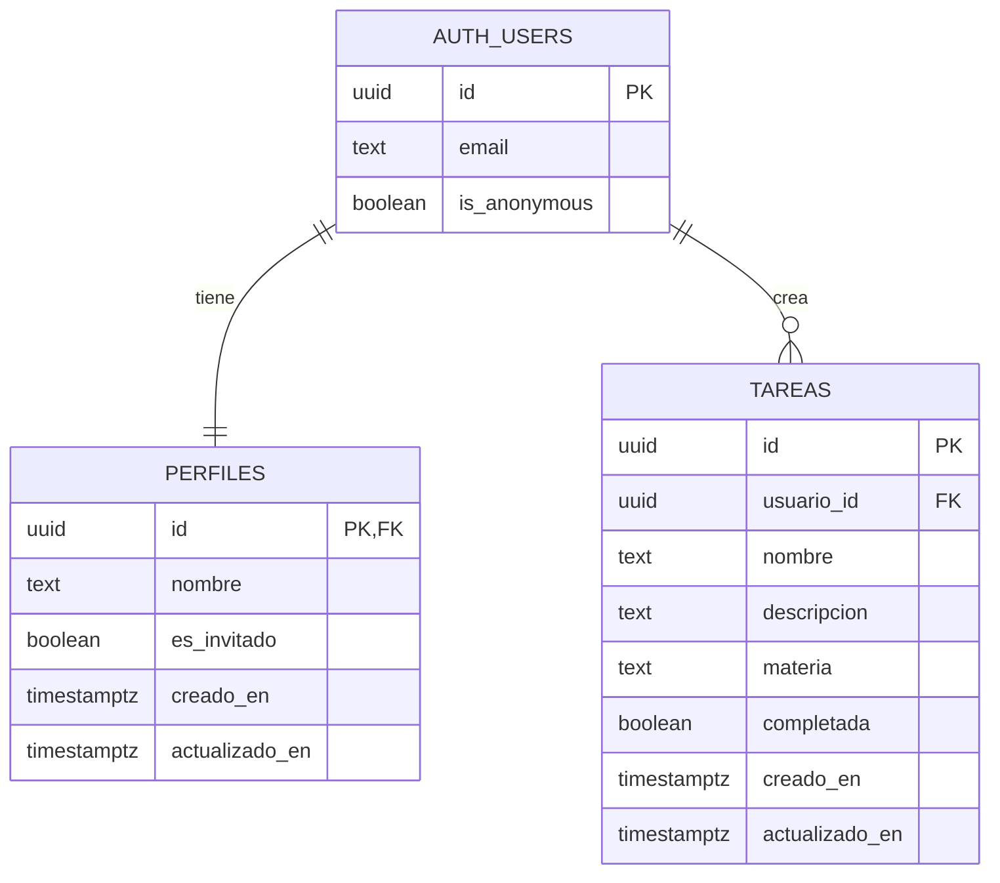

# 📅 Agenda al Día

Aplicación móvil para **organizar tareas escolares** de forma sencilla, privada y segura. Permite registrar, consultar, filtrar, completar y eliminar tareas por materia, con sincronización en la nube y una frase motivacional diaria.

> Proyecto de la asignatura **Desarrollo de Aplicaciones Móviles** — Universidad Tecnológica de Nayarit (UTNay), Ingeniería en Tecnologías de la Información e Innovación Digital, grupo DSM-42.


---

## 📋 Tabla de contenido

- [Características](#-características)
- [Capturas de pantalla](#-capturas-de-pantalla)
- [Tecnologías](#-tecnologías)
- [Arquitectura](#-arquitectura)
- [Modelo de datos](#-modelo-de-datos)
- [Seguridad](#-seguridad)
- [Configuración del proyecto](#-configuración-del-proyecto)
- [Empaquetado y distribución](#-empaquetado-y-distribución)
- [Sensores y recursos multimedia](#-sensores-y-recursos-multimedia)
- [Mejoras futuras](#-mejoras-futuras)
- [Equipo](#-equipo)

---

## ✨ Características

- 🔐 **Inicio de sesión** con correo y contraseña (Supabase Auth).
- ➕ **Crear tareas** con nombre, descripción y materia.
- 📋 **Vista "Hoy / Todas"** con todas las tareas del usuario.
- ⏳ **Vista "Pendientes"** y ✅ **vista "Completadas"** mediante filtros.
- ✔️ **Marcar tareas como completadas** con un toque.
- 🗑️ **Eliminar tareas** con confirmación (acción irreversible).
- 😀 **Estados vacíos** con mensajes amigables cuando no hay tareas.
- 💬 **Frase motivacional diaria** obtenida desde la API de ZenQuotes.
- 🌙 Interfaz oscura con acentos amarillos, basada en tarjetas, listas y campos de texto.

## 📱 Capturas de pantalla

> Agrega las imágenes del prototipo en una carpeta `docs/screenshots/` y actualiza las rutas.

| Inicio de sesión | Todas (Hoy) | Pendientes |
|:---:|:---:|:---:|
|  |  |  |

| Completadas | Nueva tarea | Eliminar tarea |
|:---:|:---:|:---:|
|  |  |  |

## 🛠️ Tecnologías

| Componente | Herramienta |
|---|---|
| Diseño y desarrollo de la app | [FlutterFlow](https://flutterflow.io/) |
| Base de datos y autenticación | [Supabase](https://supabase.com/) (PostgreSQL, Auth, RLS) |
| Frases motivacionales | [ZenQuotes API](https://zenquotes.io/) |
| Control de versiones y distribución del APK | GitHub (Releases) |
| Plataforma objetivo | Android |

La interfaz usa únicamente componentes nativos del entorno (botones, campos de texto, listas y tarjetas). Supabase es la única herramienta externa de backend, lo que mantiene la app ligera y fácil de mantener.

## 🏗️ Arquitectura

El diseño se documentó con diagramas de clases UML por pantalla:

| Pantalla | Clases principales |
|---|---|
| Inicio de sesión | `Usuario`, `Sesion` |
| Hoy / Todas las tareas | `Tarea`, `FraseMotivacional` |
| Pendientes | `Tarea`, `FiltroPendientes` |
| Completadas | `Tarea`, `FiltroCompletadas` |
| Sin pendientes | `Tarea`, `VistaVacia` |
| Eliminar tarea | `Tarea`, `Confirmacion` |
| Nueva tarea | `Tarea`, `Formulario` |

Clase central:

```
Tarea
─────────────────────
- idTarea: int
- nombre: String
- descripcion: String
- materia: String
- completada: boolean
─────────────────────
+ marcarCompletada()
+ mostrarTarea()
```

## 🗄️ Modelo de datos



## 🔒 Seguridad

- **Supabase Auth**: inicio de sesión con correo y contraseña.
- **Hashing con bcrypt**: las contraseñas nunca se guardan en texto plano; solo se almacena el hash irreversible.
- **UUID v4** como identificador de usuarios y tareas: únicos, aleatorios y no secuenciales, por lo que no se pueden adivinar.
- **Row Level Security (RLS)**: cada usuario solo puede ver, crear, modificar y eliminar **sus propias** tareas.
- **HTTPS** en toda la comunicación entre la app y Supabase.
- **Privacidad**: la app no accede a sensores, cámara, micrófono ni GPS.

## ⚙️ Configuración del proyecto

### Requisitos

- Cuenta de [FlutterFlow](https://flutterflow.io/)
- Proyecto de [Supabase](https://supabase.com/)
- Dispositivo o emulador Android

### 1. Clonar el repositorio

```bash
git clone https://github.com/<usuario>/<repositorio>.git
cd <repositorio>
```

### 2. Configurar Supabase

1. Crea un proyecto nuevo en Supabase.
2. Ejecuta el siguiente SQL en el *SQL Editor* (ejemplo basado en el modelo de datos; ajústalo si tu esquema real difiere):

```sql
create table public.perfiles (
  id uuid primary key references auth.users(id) on delete cascade,
  nombre text,
  es_invitado boolean default false,
  creado_en timestamptz default now(),
  actualizado_en timestamptz default now()
);

create table public.tareas (
  id uuid primary key default gen_random_uuid(),
  usuario_id uuid not null references auth.users(id) on delete cascade,
  nombre text not null,
  descripcion text,
  materia text,
  completada boolean default false,
  creado_en timestamptz default now(),
  actualizado_en timestamptz default now()
);

alter table public.perfiles enable row level security;
alter table public.tareas  enable row level security;

create policy "Perfil propio" on public.perfiles
  for all using (auth.uid() = id) with check (auth.uid() = id);

create policy "Tareas propias" on public.tareas
  for all using (auth.uid() = usuario_id) with check (auth.uid() = usuario_id);
```

3. Copia la **Project URL** y la **anon public key** desde *Project Settings → API*.

### 3. Conectar FlutterFlow

1. En FlutterFlow ve a *Settings → Integrations → Supabase* y pega la URL y la anon key.
2. Importa el esquema de las tablas.
3. Ejecuta la app en modo prueba o genera el APK.

> ⚠️ **Nunca subas al repositorio** claves privadas (`service_role`) ni credenciales de usuarios.

## 📦 Empaquetado y distribución

| Aspecto | Detalle |
|---|---|
| Formatos | **APK** (instalable, pruebas y demostraciones) y **AAB** (requerido por Google Play) |
| Plataforma de distribución | Google Play Store |
| Canales | Descarga desde Google Play, instalación manual del APK y [GitHub Releases](../../releases) |
| Herramientas de despliegue | FlutterFlow, GitHub, Supabase, ZenQuotes API |

### Instalar el APK

1. Descarga el `.apk` más reciente desde la sección [Releases](../../releases).
2. En tu Android, permite la instalación desde orígenes desconocidos.
3. Abre el archivo e instala la app.

### Requisitos para publicar en Google Play

- Cuenta de desarrollador de Google Play
- Icono, nombre, descripción y capturas de pantalla
- Clasificación de contenido
- Política de privacidad (indica que no se recopilan datos de sensores, cámara, micrófono ni GPS, y que solo se guardan las tareas ingresadas por el usuario)
- Firma digital de la aplicación
- Permisos mínimos y compatibilidad con las versiones de Android definidas

## 🎨 Sensores y recursos multimedia

**Sensores:** no se utilizan (GPS, acelerómetro, giroscopio, proximidad, luz, cámara, micrófono, huella). Toda la información la ingresa el usuario con teclado y pantalla táctil, lo que reduce el consumo de batería y mejora la privacidad.

**Recursos:**
- **Texto:** tareas, materias, frase motivacional y mensajes como "No tienes pendientes".
- **Iconos e imágenes:** acciones (agregar, eliminar, filtrar) y la carita sonriente del estado vacío.
- **Colores:** amarillo para inicio de sesión, verde para tareas y azul para la frase motivacional.
- **Sin audio ni video.**

## 🚀 Mejoras futuras

- 🔔 Recordatorios y notificaciones
- 📊 Estadísticas de tareas
- ✏️ Edición avanzada de tareas

## 👥 Equipo

| Integrante | Matrícula |
|---|---|
| López Corona Angel David | TIC-330053 |
| Esparza Valenzuela William Brandom | TIC-330017 |
| Fregozo Padilla Kevin Paul | TIC-330090 |
| Cortes Ramírez Paula Michelle | TIC-330071 |

**Docente:** Nadia Teresa Adaile Benítez
**Institución:** Universidad Tecnológica de Nayarit — Ingeniería en Tecnologías de la Información e Innovación Digital, grupo DSM-42.

---

## 📄 Licencia

Proyecto académico de uso libre con licencia del [MIT](LICENSE).
